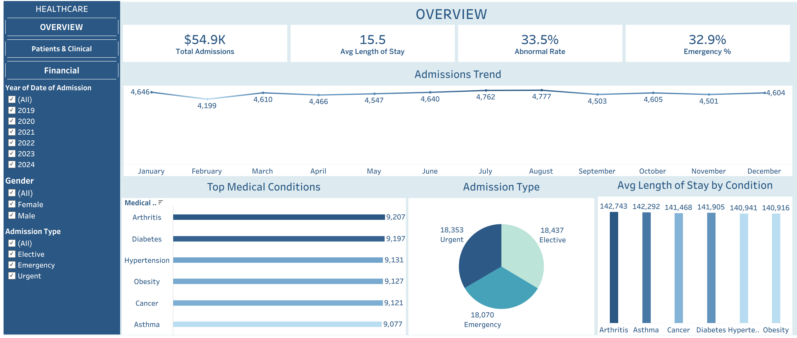
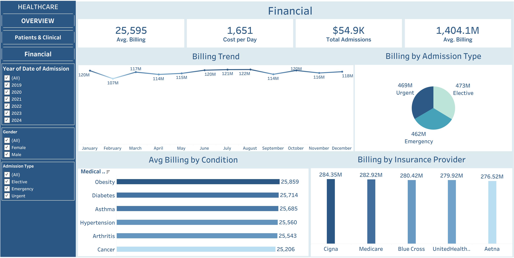

# 🏥 Healthcare Patient Outcomes Analytics

---

## 📌 Business Overview
This project delivers a comprehensive, data-driven solution for healthcare performance monitoring. By combining **Python** for Data Processing (ETL) and **Tableau** for advanced interactive visualization, it connects clinical outcomes, demographic distributions, and financial billing metrics to empower healthcare executives and hospital managers to optimize decision-making.

---

## 🛠️ Project Architecture & Tools
- **Python (Pandas, NumPy):** Automated data extraction, handling missing values, data validation, and Exploratory Data Analysis (EDA).
- **Tableau Desktop:** Multi-page dashboard construction, custom calculations, container-based layouts, and dynamic slicers/filters.
- **Figma:** Conceptual design, color palette structuring, and Navigation Panel UI framing.

---

## 📊 Dashboard Pages & Insights

### 1️⃣ Overview Page
Focuses on macro-level operational metrics, patient admissions, and baseline statistics.
- **Key Metrics:** Total Admissions, Average Length of Stay, Abnormal Test Rates, and Emergency Percentage.
- **Admissions Trend:** Tracking monthly volume variations to forecast bed capacity demands.

---

### 2️⃣ Patients & Clinical Page
Delivers deep dive analytics into medical conditions, lab results, and patient demographics.
- **Clinical Performance:** Test results (Normal, Inconclusive, Abnormal) segmented by medical conditions.
- **Prescriptions & Demographics:** Analysis of top-prescribed medications, patient age group buckets, and gender breakdowns.

---

### 3️⃣ Financial & Billing Page
Monitors hospital revenue streams, average billing per condition, and insurance carrier distribution.
- **Financial Drivers:** Billing trends over time and billing breakdown by admission types (Urgent, Elective, Emergency).
- **Insurance Provider Performance:** Revenue contributions from top health insurance providers.

---

## 💡 التوصيات المقترحة (Business Recommendations)

1. **إدارة القدرة الاستيعابية وتقليل فترات الإقامة:**
   * التوجيه بتحسين جدولة الطواقم الطبية والموارد في الأشهر التي تشهد ارتفاعًا في معدلات دخول الحالات الإرجاعية (Admissions Trend) لتقليل متوسط فترة إقامة المريض (**15.5 يوم**) دون التأثير على جودة الرعاية الطبية.

2. **تحسين بروتوكولات الفحوصات الطبية:**
   * تركيز الفرق الطبية على متابعة الحالات المزمنة (مثل السكري والضغط) نظراً للارتفاع الملاحظ في نتائج الفحوصات غير الطبيعية (**33.5% Abnormal Rate**)، وتوفير برامج مراقبة دورية للحد من دخول حالات الطوارئ.

3. **التفاوض مع شركات التأمين الصحي:**
   * إعادة مراقبة ومراجعة اتفاقيات ومستحقات التأمين الصحي مع كبار المزودين (مثل Cigna, Medicare, Blue Cross)، بناءً على تحليل متوسط تكلفة الفواتير حسب نوع الحالات وحجم الإشغال لرفع هوامش التحصيل الربحي.

4. **إدارة المخزون الدوائي:**
   * ضبط سلاسل الإمداد للشركات والموردين لضمان توافر الأدوية الأكثر طلبًا وإصدارًا (مثل Lipitor وIbuprofen) لتجنب أي نقص في الاستجابة للعلاج داخل المستشفى.

---

### 👤 Created By:
**Ebrahim Mustafa** — *Data Analyst & BI Analyst*
